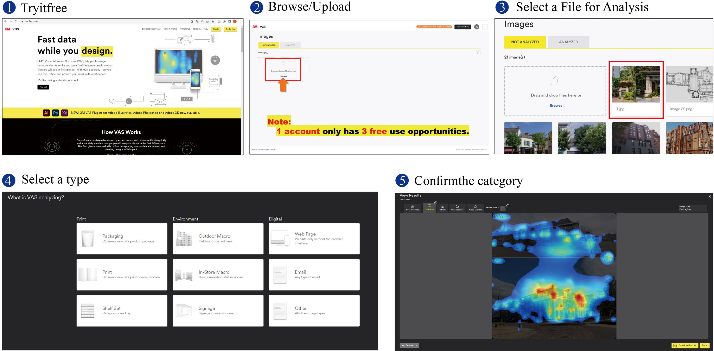
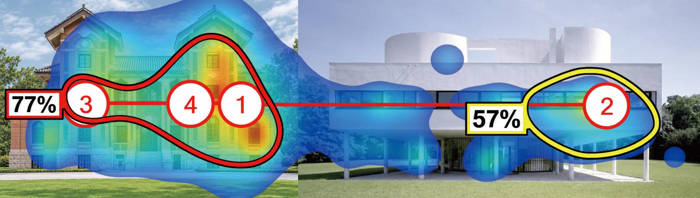
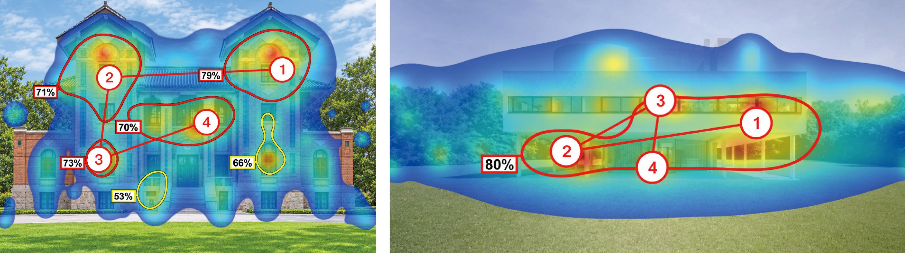

# 使用 3M VAS 进行建筑图像分析

Shuyun Wang and Bin Jiang  
LivableCityLAB, Thrust of Urban Governance and Design  
The Hong Kong University of Science and Technology (Guangzhou), China  
Email: [swang585@connect.hkust-gz.edu.cn](mailto:swang585@connect.hkust-gz.edu.cn) [binjiang@hkustgz.edu.cn](mailto:binjiang@hkustgz.edu.cn)  
2026年10月24日

## 实验与教程的文献依据

建筑VAS应用参考 **Lavdas、Salingaros、Sussman（2021）**。 **Ro、Huffman（2025）**为联合扫描、建筑AOI和四报告综合分数提供方法参考。此前近远景与R值实验参考 **Lavdas、Salingaros（2022）第3.5与4.3节**，其中R公式和2.35倍数字放大是特定研究方法，不是3M默认设置。**Berto、Barbiero、Salingaros（2022）**是将VAS与恢复性感知对照的相关建筑立面研究。**Alexander（2002–2005）**及 **Jiang、de Rijke（2023）**提供living structure的理论背景，不能据此说VAS已经验证了整体性。

## 1 明确用途

3M VAS 预测最初约3–5秒的视觉注意，提供热图、热点和预测注视顺序。它不直接测量美感、生命度或整体性，也不是受试者真实眼动记录。与 L-score、B-score、MOST 对照时，允许结果不一致。[1]

## 2 检查输入

- **格式与清晰度：**官方支持 RGB 的 JPG、PNG、PDF，建议至少 **600 × 600 像素**。更小的图可能被系统自动缩放并影响结果。看实际像素，不能只改 DPI；放大低清图不会恢复真实细节。[1,2]
- **可比性：**尽量统一画布尺寸、分辨率、取景和对象呈现尺度，保留比例。官方建议实景照片采用较宽的横向取景；这不等于把建筑旋转90度，也不强制拼图必须横排。视角、光照、人物、树木遮挡等差异必须记录。[2]
- **干净输入：**不要上传旧热图、热点圈、注视编号、浏览器界面或后来添加的比较文字。保留原件和署名，不擦除水印，不用生成式增强补造细节。无法安全排除的原有标记应保留并说明其干扰。

以下比较控制、归档和解释规范属于研究建议，不是3M额外上传门槛。

## 3 先定比较，再扫描

**联合扫描**把两图放进同一画布，研究共享视野中的注意分布；这与 **Ro、Huffman（2025）**采用的成对图像比较方式相对应。记录面板位置、间距、尺度；必要时交换左右或上下位置复扫，交换整块面板，不镜像或拉伸内容。两个位置的结果都要报告。

**单独扫描**分别描述各图内部的注意分布。两次扫描的百分比不能直接解释为两图之间的注意竞争。网站并排查看两份结果，也不等于联合扫描。

根据实际研究对象选类别：室外建筑照片一般用 **Outdoor Macro**；普通非零售室内、线稿等可能用 **Other**，以当前界面说明为准。同一对照固定类别；官方说明不同内容类型使用适配算法，不能看完结果再挑有利类别。[3]

## 4 操作与存档

1. 进入 [VAS Portfolio](https://vas.3m.com/app/portfolio)，上传获授权的图片，选中后核对文件名、方向和类别。
2. 决定是否需要 **AOI（感兴趣区）**。只描述热图可不画；需要比较指定区域的原生概率时，扫描前统一范围规则。整张照片面板、建筑本体、后处理 ROI 是不同对象，不能混称。排除拼图间隙。[3]
3. **Analyze 只提交一次。**保存输入、类别、AOI坐标或“无”、日期、结果链接和原生报告。中断后先找回已有结果。此前界面的 **Re-analyze 会清除旧结果**，新条件用新版本，不拿它查看旧类别。

## 5 读图与交付

- **Heatmap：**颜色表示预测注意分布，红色不能直接解释为更美，无热度也不代表绝对看不见。[1]
- **Hotspots／AOI：**百分比是某区域被看到的预测概率，不是整图注意力份额。多个区域可以被同一人看到，不能相加、凑成100%或归一化成美感分数。热点值不能冒充另一范围的AOI值。[1]
- **Gaze Sequence：**编号是预测顺序，不是实测个人轨迹或停留时长。[1]

单图的整图AOI概率可能接近饱和，不适合直接区分建筑。热图覆盖率、R值或综合指标须另列公式与阈值，注明是研究者后处理，不能说成3M官方美感或整体性指标。

提交 **原图＋预处理记录＋扫描设置＋原生报告＋简短解释**。记录出处、署名、像素、哈希、排版、类别、AOI、日期和缺失项；逐一核对百分比和编号。展示性合成图须标明经过编辑，并保留未改动的原生报告。

推荐表述：“在所记录的排版与类别下，VAS预测注意集中于这些部位。”若进一步讨论整体性或美感，需要其他方法与证据支持。

**来源**：[1] [3M VAS FAQs](https://vas.3m.com/faqs)；[2] [3M VAS Support](https://www.3m.com/3M/en_US/visual-attention-software-us/support/)；[3] [How it Works](https://vas.3m.com/howitworks)。核查日期2026年10月24日。原讲义作者 **Hongkai Zhang、Bin Jiang**；本教程是其VAS部分的补充说明，未改写原作者署名。

Ro、Huffman（2025，第2.1节）区分了VAS建筑AOI与ImageJ建筑ROI，并在其研究中采用矩形AOI；这不是所有VAS实验的强制画框规则。其Visual Attention Coherence score将热图、热点、注视顺序和AOI四类报告的指标取算术平均，属于作者提出的综合指标，与Lavdas、Salingaros（2022）的R值不同。采用或改编时，应写清分量、换算、阈值和与原文的差异。

## References

Alexander C. (2002–2005), *The Nature of Order: An Essay on the Art of Building and the Nature of the Universe*, Center for Environmental Structure: Berkeley, CA.

Berto R., Barbiero G. and Salingaros N. A. (2022), Biophilic design of building façades from an evolutionary psychology framework: Visual Attention Software compared to Perceived Restorativeness, *Visions for Sustainability*, 19, 91–124. https://doi.org/10.13135/2384-8677/7054

Jiang B. and de Rijke C. (2023), Living images: A recursive approach to computing the structural beauty of images or the livingness of space, *Annals of the American Association of Geographers*, 113(6), 1329–1347. https://doi.org/10.1080/24694452.2023.2178376

Lavdas A. A., Salingaros N. A. and Sussman A. (2021), Visual Attention Software: A new tool for understanding the “subliminal” experience of the built environment, *Applied Sciences*, 11(13), 6197. https://doi.org/10.3390/app11136197

Lavdas A. A. and Salingaros N. A. (2022), Architectural beauty: Developing a measurable and objective scale, *Challenges*, 13(2), 56. https://doi.org/10.3390/challe13020056

Ro B. R. and Huffman H. (2025), Architectural design, visual attention, and human cognition: Exploring responses to federal building styles, *Planning Practice & Research*, 40(3), 447–486. https://doi.org/10.1080/02697459.2024.2342755

## 插图示例

图1：Hongkai Zhang、Bin Jiang讲义第5页的历史操作图。界面和免费次数不代表当前规则；截图中的Packaging也不是本教程对建筑外景的类别建议，按正文规则选择。

图2：同页的联合与单独扫描示例。原例的照片和取景并非完全一致，只用于说明分析形式，不能据此把差异全部归因于扫描方式。保留原百分比与编号；它们不是美感分数，也不是本教程新跑出的结果。图片权利与来源说明见assets/NOTICE.md。

## GitHub 仓库

教程和Codex skill：[https://github.com/eleanor-wsyy/vas-scanning-tutorial](https://github.com/eleanor-wsyy/vas-scanning-tutorial)

仓库访问权限以GitHub当前的可见性设置为准。
